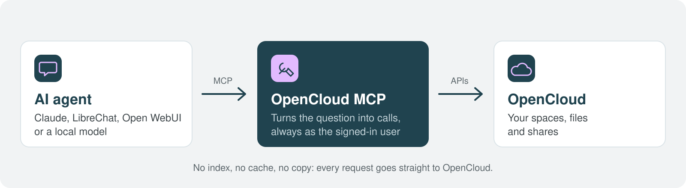
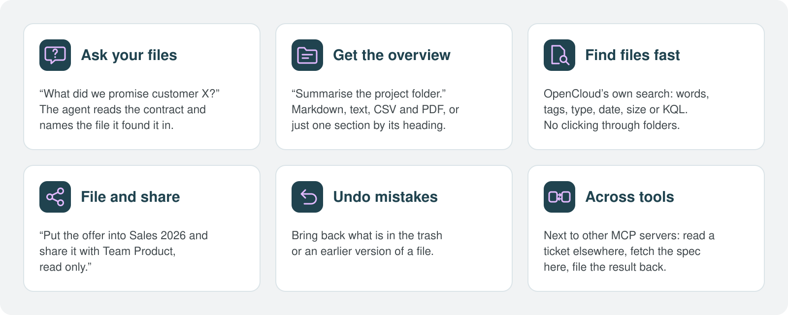
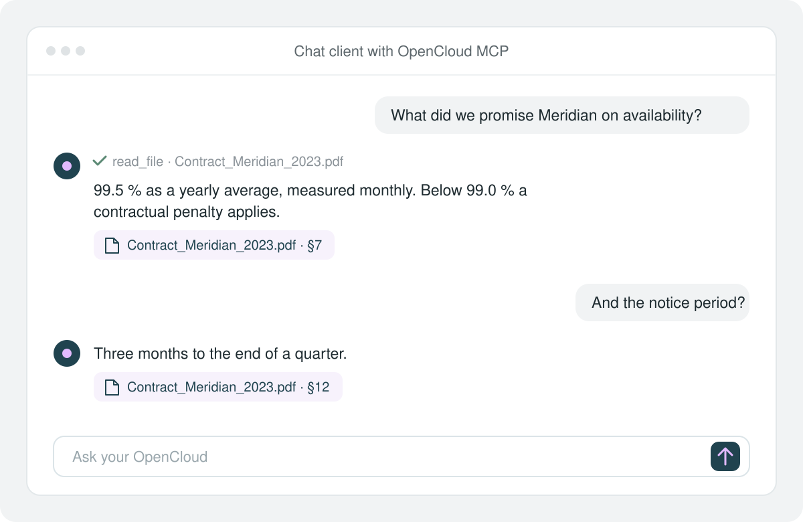

# OpenCloud MCP Server

[](https://opensource.org/licenses/Apache-2.0) 

> [!WARNING]
> **Lab status:** This project is under active development. It is intended for testing and evaluation, not production use. Features, APIs and behavior may change without notice.

An AI model knows a lot, but nothing about your organization: what you promised a customer or
what the last project decided is in your files. This [MCP](https://modelcontextprotocol.io) server
connects an MCP client to [OpenCloud](https://github.com/opencloud-eu/opencloud), so the model
can look there, always as the signed-in user and with that user's permissions.



## What you can do with it



A few things to ask:

- "What did we promise Meridian on availability?"
- "Summarise the project folder before my meeting."
- "Find the signed offers from last quarter tagged *open*."
- "Put the offer into *Sales 2026* and share it with Team Product, read only."
- "Bring back the version of the budget from Monday."



In detail, the server lets a client:

- **read**: list spaces and folders, read markdown, text, CSV and PDF, open one section of a
  document by its heading, see previews of images and documents
- **search**: OpenCloud's own search by words, folder, tags, type, date, size or KQL
- **write**: write text files, create folders, copy, move and delete
- **undo**: restore from the trash and earlier versions of a file
- **share**: with people and groups, by links; accept what others share
- **organize**: tags, favorites, activity, notifications, open a file in an office app
- **manage spaces**: as a space admin, create project spaces and manage their members

Every tool is listed in [Tools](docs/tools.md). The documents are MCP resources too, with notice
when one changes.

## What the agent can and cannot do

- **Your permissions, nothing more.** Every request goes to OpenCloud as the signed-in user. The
  agent sees what that user sees and can do what that user may do.
- **Read only if you want.** `--read-only` offers only the tools that change nothing, and
  `--toolsets` only the groups you name. A client cannot talk the server out of either.
- **Writing tools say so.** Every tool carries MCP annotations (`readOnlyHint`, `destructiveHint`),
  so the client can ask before anything is changed or deleted.
- **No copy of your data.** The server keeps no index, no cache and no background copy.
- **Only your OpenCloud and your provider.** Calls with a user's token go to the configured
  OpenCloud only: a request or redirect to any other host is stopped before it leaves. With
  OpenID Connect the server also talks to your own provider, for the token exchange. It does not
  fetch files from URLs.
- **Left out on purpose:** admin and education routes, app tokens and passwords, locks, binary
  uploads. See [Tools](docs/tools.md#left-out) for why.

Want no data to leave the house? Run the model locally, for example with Ollama or vLLM. The
server and the tools stay the same.

## Install

Tested with OpenCloud 9.0.0. Earlier versions are not supported; later ones should work but are
not checked.

From source, with [mise](https://mise.jdx.dev) providing Go and the linter:

``` console
mise install
mise run build      # bin/opencloud-mcp
```

Or as a container image:

``` console
mise run image      # opencloud-mcp:dev
docker run -i --rm -e OPENCLOUD_URL -e OPENCLOUD_USER -e OPENCLOUD_APP_TOKEN opencloud-mcp:dev
```

## Quick start

Create an [app token](docs/configuration.md#app-tokens) for the user, then connect a client.

Claude Code:

``` console
claude mcp add opencloud \
  -e OPENCLOUD_URL=https://cloud.example.com -e OPENCLOUD_USER=alice -e OPENCLOUD_APP_TOKEN='<app token>' \
  -- /path/to/opencloud-mcp
```

Claude Desktop, Cursor and other clients that take a JSON config:

``` json
{
  "mcpServers": {
    "opencloud": {
      "command": "/path/to/opencloud-mcp",
      "env": {
        "OPENCLOUD_URL": "https://cloud.example.com",
        "OPENCLOUD_USER": "alice",
        "OPENCLOUD_APP_TOKEN": "<app token>"
      }
    }
  }
}
```

To start carefully, add `"args": ["--read-only"]`.

Any MCP client works, over stdio or streamable HTTP: Claude, LibreChat and Open WebUI as well as
clients for local models. [Configuration](docs/configuration.md#connect-a-client) has the HTTP
setup.

## Modes

| Mode                          | Who it acts as             | Sign-in                                                    |
| ----------------------------- | -------------------------- | ---------------------------------------------------------- |
| stdio                         | one user                   | app token                                                  |
| HTTP, one user                | one user, loopback only    | app token                                                  |
| HTTP, sign-in per request     | every user of the instance | app token, or MCP authorization with OpenID Connect        |

With OpenID Connect the server exchanges the client's token for one issued for OpenCloud
(RFC 8693) and keeps nothing between requests. Settings are in [Configuration](docs/configuration.md),
the details of sign-in in [Sign-in](docs/sign-in.md).

## Try it

`compose.yaml` runs OpenCloud, an OpenID Connect provider (Rauthy), this server and LibreChat on
this machine. It needs an OpenAI-compatible model API:

``` console
cp .env.example .env    # then set OPENAI_API_BASE_URL, OPENAI_API_KEY and DEFAULT_MODELS
mise run demo
```

Open http://localhost and sign in as `alice@example.com` / `demo`. The rest is in
[Demo](docs/demo.md).

## At a glance

| Topic     | Details                                                                     |
| --------- | --------------------------------------------------------------------------- |
| Protocol     | MCP 2026-07-28 (stateless, `server/discover`, `subscriptions/listen`) and the older revisions as far as the [go-sdk](https://github.com/modelcontextprotocol/go-sdk) serves them |
| Modes        | stdio, HTTP as one user, HTTP with sign-in per request; see [Modes](#modes) |
| Sign-in      | app token (basic auth) or MCP authorization with OpenID Connect and token exchange (RFC 8693) |
| Tools        | 57 in 10 toolsets, limited with `--toolsets`, read only with `--read-only`  |
| APIs         | LibreGraph, WebDAV, OCS and the app provider                                |
| Resources    | documents as `opencloud:///spaces/<space id>/<path>`, with change notices   |
| Left out     | admin and education routes, credentials, locks, binary uploads; see [why](docs/tools.md#left-out) |
| Tested with  | OpenCloud 9.0.0                                                             |
| Runs as      | one Go binary or a container                                                |
| License      | Apache 2.0                                                                  |

## Docs

- [Configuration](docs/configuration.md): the settings, the three modes, app tokens, connecting a client
- [Tools](docs/tools.md): every tool, the documents as resources, and search
- [Sign-in](docs/sign-in.md): app tokens and OpenID Connect per HTTP request
- [Demo](docs/demo.md): the compose demo and its users
- [Development](docs/development.md): the tests and the live test against the demo
- [Evaluation](docs/evaluation.md): questions for a model, to see whether the tools guide it

## License

Apache 2.0, see [LICENSE](LICENSE).
